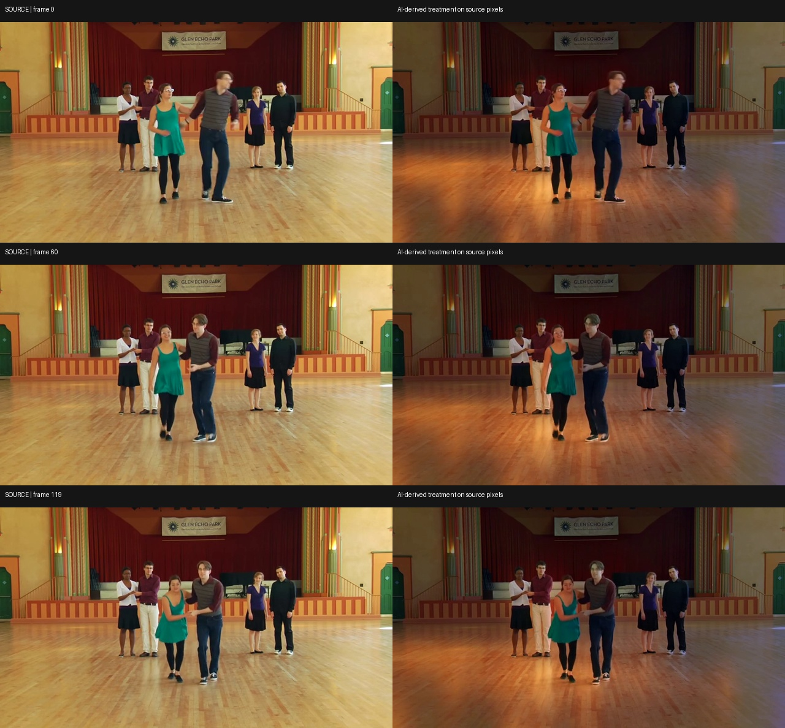

# CINEMA

**Turn a performance into a cinematic scene.**

*One performance. Reimagined.*

[Open CINEMA](https://madeincinema.vercel.app) · [Watch the demo film](submission/assets/cinema-final-demo.mp4) · [See the implementation](docs/subject-aware-cinematography.md)

CINEMA is a browser-based filmmaking studio for exploring new visual treatments of footage you've already captured. Record or upload a performance, choose a direction, compare the original and processed films, and export an MP4.

The performance is the starting point—not a disposable prompt. Instead of asking a video model to invent the entire shot again, CINEMA experiments with using AI to direct the look while keeping the original people, movement, framing, and timing.



*An actual five-second, source-preserving appearance-transfer experiment. This is the offline B showcase, not an output generated on demand by the live Directed light worker.*

## The working studio

1. **Capture or upload** a five-second take, or use the licensed sample performance.
2. **Choose a treatment.** Directed light is the source-preserving IC-Light experiment; Silver screen is an alternative LTX video-generation experiment.
3. **Process a real video** using a separate inference worker. The interface reports actual queued, rendering, completed, and failed states.
4. **Compare and export.** Play the original against the result and download the processed MP4.

The application includes browser camera capture, FFmpeg normalization, preserved source footage, asynchronous jobs, playback, export, and browser-side session recovery. When the temporary worker is offline, CINEMA reports the limitation; it does not substitute a prerecorded result for a new upload.

## Real AI processing on a Kaggle GPU

CINEMA's **Directed light** pipeline has been connected to a temporary **Kaggle GPU notebook** through a FastAPI worker and an HTTPS Cloudflare tunnel. The deployed Vercel application submitted the built-in performance and received an actual processed video from that GPU-backed path.

The pipeline performs these steps:

- **Source-conditioned reference:** IC-Light generates a lighting reference using the submitted performance, rather than an unrelated stock image.
- **People segmentation:** a pretrained LRASPP-MobileNetV3 model estimates moving foreground masks.
- **Motion analysis:** OpenCV optical flow tracks changes between source frames.
- **Source-preserving compositing:** separate foreground and background treatments alter the atmosphere while retaining source-frame faces and movement.
- **Video delivery:** FFmpeg encodes the MP4; the worker exposes authenticated submission/status requests and time-limited signed output links.

Each job has a separate identifier and input. The result metadata is checked against the submitted source hash. We also processed a **different uploaded video** through the real local IC-Light worker and verified playback and MP4 export.

**What the GPU result proves:** the deployed app, private worker connection, actual AI inference, job polling, and result playback can operate together.

**What it does not prove:** always-on hosting, consistently realistic lighting, or a production-level GPU throughput benchmark. Kaggle sessions and Quick Tunnel URLs can expire. The Directed light result is still visibly experimental, especially around subject edges.

## Results

| Experiment | Evidence | Status |
| --- | --- | --- |
| **B — Appearance transfer** | [Finished film](docs/evidence/subject-aware-v1/baseline-appearance-transfer.mp4) | Strongest visual showcase; AI-directed, motion-aware treatment produced **offline** |
| **C — Directed light** | [Finished film](docs/evidence/subject-aware-v1/subject-aware.mp4) | Real source-conditioned IC-Light processing; live built-in-sample GPU demonstration, with imperfect mattes |
| **A / B / C** | [Side-by-side comparison](docs/evidence/subject-aware-v1/comparison-abc.mp4) | Same performance, directly inspectable methods |

The offline appearance-transfer film contains **120 frames at 854 × 480**, with the source movement and timing preserved. The separate **fresh-upload local test** processed 48 frames with a new AI reference and verified an export. These measurements describe different experiments; they are not interchangeable GPU performance claims.

[Full technical report, model revisions, actual media and limitations →](docs/subject-aware-cinematography.md)

## Architecture

```text
Browser capture / upload
        |
        v
Next.js API + FFmpeg normalization
        |
        v
Signed render job ----------------------+
        |                               |
        v                               v
FastAPI GPU worker               Browser job polling
        |
        v
IC-Light reference + people masks + optical flow
        |
        v
Source-frame compositing + FFmpeg output
        |
        v
Original / treatment comparison -> MP4 export
```

The frontend is deployed on **Vercel**; model inference runs on a **separate GPU worker**, not inside a Vercel function. The connection uses server-only `CINEMA_BACKEND_URL` and `CINEMA_BACKEND_TOKEN`. Workers can be moved between hosts that implement the same FastAPI contract; in-progress jobs and files do not automatically migrate.

## Run locally

Requires Node.js 22+.

```bash
npm ci
cp .env.example .env.local
npm run dev
```

Open [localhost:3000](http://localhost:3000). The capture, sample, preview, and video-preparation flow works without inference credentials; actual rendering requires a reachable worker.

To connect the subject-aware worker, set these **private server-side** variables:

```dotenv
CINEMA_BACKEND_URL=https://your-worker.example
CINEMA_BACKEND_TOKEN=your-private-worker-token
JOB_SIGNING_SECRET=your-independent-random-signing-secret
```

Never commit credentials or prefix them with `NEXT_PUBLIC_`. See [Kaggle setup](docs/DEMO-KAGGLE.md) and [backend contract/security](docs/backend-connection.md).

```bash
npm run typecheck
npm test
npm run build
```

## Built with

Next.js · React · TypeScript · FastAPI · Python · IC-Light · torchvision · OpenCV · FFmpeg · Kaggle GPU · Cloudflare Tunnel · Vercel.

We tested LTX and Wan VACE during development, but built our source-preserving approach because generated footage did not consistently maintain the original performance. CINEMA integrates existing pretrained models; it does not claim to have trained them.

**Credits and licensing:** the example performance is a licensed ARTSEDGE / Kennedy Center Charleston dance excerpt (CC BY 3.0). Application code is MIT-licensed; model weights, codecs and footage have separate terms. See [third-party attribution](THIRD_PARTY.md) and [media/model provenance](submission/ATTRIBUTIONS.md).

*Built for Banana Hacks 2026.*
